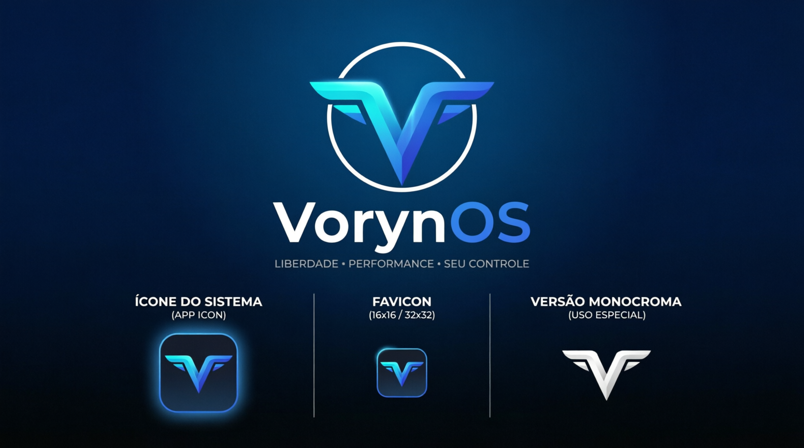

<div align="center">

# VorynOS

### Freedom • Performance • Your Control

**An independent operating system built from scratch to provide direct hardware control, efficiency, and technological freedom.**

[](https://ziglang.org/)
[](https://github.com/CeoMatheusDev/VorynOS/releases/tag/v0.1.0-dev.2)
[](LICENSE)
[](#architecture)
[](#project-status)

[**Overview**](#overview) ·
[**Current Status**](#project-status) ·
[**Building**](#building) ·
[**Architecture**](#architecture) ·
[**Documentation**](#documentation) ·
[**Release Notes**](https://github.com/CeoMatheusDev/VorynOS/releases/tag/v0.1.0-dev.2)



</div>

---

## Overview

**VorynOS** is an independent operating system project developed primarily in **Zig**, using **x86_64 Assembly** for operations requiring direct control over the processor architecture.

The project prioritizes:

- **Independence:** A kernel, bootloader, contracts, and fundamental mechanisms developed specifically for VorynOS.
- **Performance:** Explicit control over memory, execution, interrupts, and communication between components.
- **Efficiency:** Reduced unnecessary abstractions, external dependencies, and operational overhead.
- **Security:** An architecture designed around isolation and capability-based access control, with progressive implementation.
- **Modularity:** Components with clearly defined responsibilities and documented interfaces.
- **Transparency:** Open development, technical documentation, and a clear distinction between implemented and planned features.

VorynOS **is not a Linux distribution, a Windows fork, a BSD variant, or an interface built on top of another operating system**.

Its bootloader and kernel are original implementations.

The project is currently in its early development stages and **does not yet constitute a complete operating system suitable for everyday use**.

---

## Project Status

> **Published version:** `v0.1.0-dev.2` — [Release Notes](https://github.com/CeoMatheusDev/VorynOS/releases/tag/v0.1.0-dev.2)  
> **Initial architecture:** `x86_64`  
> **Primary language:** Zig 0.17.0  
> **Boot firmware:** UEFI  
> **License:** GPL-3.0-only  
> **Last documentation revision:** October 22, 2026

The current development release focuses on **process fault recovery and kernel reliability**. User-mode exceptions now terminate the affected process without halting unaffected tasks; exception-frame handling, physical memory accounting, firmware memory-map safety, and heap alignment have been corrected. The release documents a three-process QEMU fault-recovery scenario and execution of **36 unit tests**. This remains an experimental pre-release, not a production-ready operating system.

The reorganization of public milestones is documented in [VERSIONING-RESET-2026](docs/releases/VERSIONING-RESET-2026.md).

Development is organized into incremental milestones, each with technical acceptance criteria and documented evidence of functionality.

### Milestone Progress

| Milestone | Description | Status |
|:---:|---|:---:|
| F0 | Foundation, toolchain, build system, and documentation | ✅ Completed |
| F1 | UEFI bootloader and kernel initialization | ✅ Completed |
| F2 | Processor structures, interrupts, and memory | 🟢 Locally Tested |
| F3 | Threads, scheduler, processes, syscalls, and IPC | 🟡 In Development |
| F4 | Storage and file systems | 📋 Proposed |
| F5 | Runtime, SDK, and native applications | 📋 Proposed |
| F6 | Graphics subsystem and desktop environment | 📋 Proposed |
| F7 | Drivers, networking, audio, and physical hardware | 📋 Proposed |
| F8 | Compatibility with external formats and APIs | 📋 Proposed |
| F9 | Artificial intelligence infrastructure | 📋 Proposed |
| F10 | Installation, security, recovery, and production readiness | 📋 Proposed |

**Important:** These statuses reflect the documented content published on the `main` branch. Features developed only in local environments are not considered implemented in the public repository.

See the [technical roadmap](docs/roadmap/phase-status.md) for each milestone's objectives, acceptance criteria, limitations, and risks.

---

## Implemented Features

### VNB — Voryn Native Boot

An independent UEFI bootloader implemented in Zig for the x86_64 architecture.

Implemented responsibilities:

- Initialization as a UEFI application.
- Communication with firmware services.
- Diagnostics through the UEFI console and serial port.
- Framebuffer discovery using GOP.
- Identification of pixel formats and framebuffer properties.
- Retrieval and normalization of the UEFI memory map.
- Loading the kernel image from the EFI volume.
- ELF64 structure validation.
- Loading kernel segments into memory.
- Applying the relocations required by the relocatable kernel image.
- Preparing the boot handoff contract.
- Terminating boot services through `ExitBootServices`.
- Retrying boot service termination when the memory map changes.
- Controlled transfer of execution to the kernel.

**Implementation:** `boot/uefi/`

### VNK — Voryn Nucleus Kernel

An independent kernel implemented in Zig and Assembly.

The kernel provides an initial functional infrastructure for processor management, memory management, and interrupt handling.

**Initialization and x86_64 Architecture**

- Custom entry point.
- Initial stack configuration.
- Validation of the contract received from the bootloader.
- Processor feature identification through CPUID.
- Global Descriptor Table (GDT) configuration.
- Task State Segment (TSS) configuration.
- Interrupt Descriptor Table (IDT) configuration.
- Exception handling with register diagnostics: an exception that comes
  from the user mode kills the process, and the kernel continues.
- Initial hardware interrupt configuration.
- Remapping of the 8259 interrupt controllers.
- Programming the 8254 timer at 100 Hz.
- Initialization of the coprocessor, which the firmware leaves disabled.

**Task Execution**

- Preemptive scheduler driven by timer interrupts.
- Task context containing the complete processor register frame: all fifteen general-purpose registers are preserved during each context switch.
- Round-robin scheduling policy designed to prevent task starvation.
- Kernel tasks with dedicated stacks, and a kernel stack separated from the code stack, ensuring that the processor return frame is never stored on a page writable by user-mode code.
- Task structure prepared for privilege level 3.
- User-page mappings in dedicated page tables.
- System calls through the `syscall` instruction, with a handler implemented in Zig.
- System call contract with eight calls, including validation of user memory ranges against the calling process's page tables before the kernel accesses user memory.
- Context-switch cost measurement using the processor's time counter.
- A user-mode exception that **kills the process** instead of the machine:
  the process is marked as terminated, the processor frame is rewritten to a
  kernel loop, and the scheduler selects another task.

**Processes**

- A dedicated address space for each process, with kernel page-table mappings copied into it and the user-mode window as the only region owned by the process.
- Address-space switching alongside task context switching.
- Process isolation: two processes can use the same virtual address without accessing the same physical pages.
- A dynamically selected user-mode window positioned outside the kernel image and assigned to the task during creation.
- Copying a memory block from one process to another, reading from the source address space and writing to the destination address space.
- VNX message channels supporting message delivery between two processes, with delivery latency measured using the processor clock.
- **Capability fabric of the VNC**: the kernel holds the table of the capabilities and every process holds a set of them. A process that does not hold the capability of a channel does not use it, and the owner of the channel delegates the capability to another process and takes it back.
- A **blocking** system call that waits for a message: the waiting task is not scheduled, the scheduler selects another task, and message arrival wakes the waiting task with the result stored in its saved context.

**Memory Management**

- Bitmap-based physical memory manager.
- Initial physical page tracking.
- Construction of dedicated page tables.
- Page-table switching through CR3.
- Kernel and framebuffer mappings covering the entire described kernel image rather than only its first two megabytes.
- Heap with block metadata.
- Memory block splitting and coalescing.
- Basic heap corruption detection.

**Diagnostics**

- Serial communication through the UART 16550.
- Boot event logging.
- Processor exception diagnostics.
- Validation of critical structures during boot.
- Framebuffer write testing.

**Implementation:** `kernel/`

### Boot Handoff Contract

VorynOS uses a custom contract to transfer information between the bootloader and the kernel.

This contract communicates:

- Framebuffer information.
- Memory map.
- Information required for kernel initialization.
- Contract identifiers and validation data.

The structure includes versioning and structural integrity checks.

**Implementation:** `shared/handoff.zig`

**Specification:** [Boot Handoff Specification](docs/specs/boot-handoff-spec.md)

### Disk Image Tool

The project includes a custom FAT16 image builder implemented in Zig.

This tool prepares the bootable volume used in system tests.

**Implementation:** `tools/fatimg.zig`

---

## Current Limitations

VorynOS is currently in the infrastructure development stage.

The following limitations are known and documented:

| Subsystem | Limitation |
|---|---|
| Physical memory | Bitmap covering up to 4 GiB |
| Heap | Fixed 256 KiB region |
| Virtual memory | Kernel image and framebuffer mappings, with a dedicated window for each process |
| Processes | Three processes; the address-space limit is a constant defined in the paging module |
| TSS | 64-bit mode structure with a layout verified at compile time |
| Exceptions | A user-mode exception kills the process; an exception in the kernel is fatal |
| Syscalls | Ten system calls, with verified return to user mode |
| IPC | Message delivery and waiting between two processes are verified; ordering, guaranteed delivery, and synchronization are not provided |
| Waiting | No timeout support; a task waits on one channel and one endpoint |
| Capabilities | The model covers the channels of the VNX; the process still accesses its entire address space |
| Storage | No operational kernel file system |
| Drivers | No general-purpose driver infrastructure |
| Graphical interface | Not implemented |
| Physical hardware | No documented validation |

User-mode processes execute at privilege level 3, write to their own data pages, invoke the kernel through the `syscall` instruction, and receive results in the same register.

Each process has its own address space. Two processes using the same virtual address do not access the same physical pages.

The VNX message channel delivers messages between processes, and responses return through the same channel.

Interprocess memory copying performs an actual data copy: the calling process's address space remains unchanged.

Features that do not yet exist include:

- Threads.
- Timed waiting.
- The VNC capability model.
- Physical hardware validation.

These features belong to upcoming development increments.

---

## Requirements

### Development Environment

| Component | Requirement |
|---|---|
| Reference operating system | Fedora Linux 44 |
| Architecture | x86_64 |
| Zig | 0.17.0 |
| QEMU | 10.x |
| Firmware | OVMF / edk2 |
| Shell | Bash |
| Utilities | Coreutils |

The project uses Zig's native build system.

The primary development environment is Linux, but the resulting kernel is independent of the operating system used to compile it.

### Verify the Toolchain

```bash
zig version
qemu-system-x86_64 --version
```

In the reference Fedora environment, OVMF files are located at:

```text
/usr/share/edk2/ovmf/OVMF_CODE.fd
/usr/share/edk2/ovmf/OVMF_VARS.fd
```

The execution scripts use QEMU and OVMF firmware to boot the system.

---

## Building

### 1. Obtain the Source Code

```bash
git clone https://github.com/CeoMatheusDev/VorynOS.git
cd VorynOS
```

To obtain the exact published milestone:

```bash
git checkout v0.1.0-dev.2
```

**About release artifacts:** The `v0.1.0-dev.2` release provides source distribution artifacts.

No binaries are distributed with this release because the project does not yet maintain a sufficiently reproducible build pipeline to designate a binary artifact as official.

The boot image is built locally by the project itself and is used by the automated boot test.

### 2. Build the Project

```bash
zig build
```

The build process produces:

- The UEFI bootloader.
- The ELF64 kernel.
- The image-building tool.
- The boot image.

### 3. Run the Tests

```bash
zig build test
```

Runs unit tests in the host environment.

```bash
zig build qemu-test
```

Runs the automated boot test using QEMU and OVMF.

```bash
zig build check
```

Runs unit tests and the automated boot test.

### 4. Boot the System

```bash
zig build qemu
```

Starts VorynOS interactively in QEMU.

The serial console is the primary diagnostic channel.

To exit QEMU in serial terminal mode, use:

```text
Ctrl+A, X
```

### Available Commands

| Command | Purpose |
|---|---|
| `zig build` | Compile components and generate the image |
| `zig build image` | Build the boot image |
| `zig build test` | Run unit tests |
| `zig build qemu` | Boot the system interactively |
| `zig build qemu-test` | Run the automated boot test |
| `zig build check` | Run integrated verification |

### Build Artifacts

After compilation, the main artifacts are:

```text
zig-out/
└── bin/
    ├── voryn-boot.efi
    ├── voryn-kernel
    ├── voryn-fsimg
    └── vorynos.img
```

| Artifact | Description |
|---|---|
| `voryn-boot.efi` | Voryn Native Boot UEFI application |
| `voryn-kernel` | Relocatable ELF64 kernel |
| `voryn-fsimg` | FAT16 image-building tool |
| `vorynos.img` | Bootable EFI volume image |

---

## Architecture

The project's architecture is organized around a model called **Voryn Fabric**.

This model defines components with specific responsibilities and explicit communication contracts.

The architecture is documented in:

[ADR-0001 — Voryn Fabric](docs/adr/ADR-0001-voryn-fabric.md)

### Components

| Acronym | Component | Responsibility |
|:---:|---|---|
| VNB | Voryn Native Boot | UEFI initialization and kernel loading |
| VNK | Voryn Nucleus Kernel | Privileged kernel mechanisms |
| VNH | Voryn Hardware Nexus | Hardware discovery and interfaces |
| VNM | Voryn Nexus Memory | Memory management |
| VNT | Voryn Task Fabric | Tasks, threads, and scheduling |
| VNX | Voryn Exchange | Interprocess communication |
| VNC | Voryn Capability Fabric | Capability-based access control |
| VND | Voryn Device Fabric | Driver infrastructure |
| VSN | Voryn Service Node | Services and supervision |

**The names above represent the planned architecture. Not all components have functional implementations.**

Currently, published implementations focus on VNB, VNK, initial memory-management routines, and shared contracts.

### Boot Flow

```text
                 ┌─────────────────────┐
                 │    UEFI Firmware    │
                 └──────────┬──────────┘
                            │
                            ▼
                 ┌─────────────────────┐
                 │ VNB                 │
                 │ Voryn Native Boot   │
                 └──────────┬──────────┘
                            │
                     ELF64 Loading
                     Memory Map
                     GOP Framebuffer
                     Handoff Contract
                            │
                            ▼
                 ┌─────────────────────┐
                 │  ExitBootServices   │
                 └──────────┬──────────┘
                            │
                            ▼
                 ┌─────────────────────┐
                 │ VNK                 │
                 │ Voryn Nucleus Kernel│
                 └──────────┬──────────┘
                            │
              ┌─────────────┼─────────────┐
              │             │             │
              ▼             ▼             ▼
          ┌───────┐    ┌─────────┐    ┌────────┐
          │GDT/TSS│    │   IDT   │    │ Memory │
          └───────┘    └─────────┘    └────────┘
              │             │             │
              └─────────────┼─────────────┘
                            │
                            ▼
                 ┌─────────────────────┐
                 │ Initial Kernel      │
                 │ Infrastructure      │
                 └─────────────────────┘
```

This flow represents the currently implemented infrastructure without assuming the existence of additional services or a graphical environment.

### Source Code Organization

```text
VorynOS/
├── .github/
│   └── workflows/
│       └── ci.yml
│
├── boot/
│   └── uefi/
│       ├── main.zig
│       └── vnb/
│
├── kernel/
│   ├── arch/
│   │   └── x86_64/
│   ├── memory/
│   └── main.zig
│
├── shared/
│   ├── arch/
│   ├── elf64.zig
│   ├── handoff.zig
│   ├── memmap.zig
│   └── root.zig
│
├── tools/
│   └── fatimg.zig
│
├── scripts/
│   └── qemu-run.sh
│
├── tests/
│   └── integration/
│       └── boot-qemu.sh
│
├── docs/
│   ├── adr/
│   ├── architecture/
│   ├── roadmap/
│   ├── specs/
│   ├── standards/
│   └── testing/
│
├── internal/            # Development documents (excluded from source packages)
├── CONTRIBUTING.md
├── SECURITY.md
├── LICENSE
├── build.zig
├── build.zig.zon
└── README.md
```

This organization separates architecture-dependent code, shared contracts, host tools, and integration tests.

---

## Testing and Validation

The project uses multiple levels of verification.

### Unit Tests

Unit tests run in the host environment to validate components that do not directly depend on privileged execution.

These include:

- Shared structures.
- Format validation.
- Boot contracts.
- Memory managers.

### Integration Tests

Boot execution is tested in an x86_64 virtual machine using OVMF firmware.

The automated test checks **33 progress markers** emitted by the bootloader and kernel, identifying failure conditions during initialization.

Kernel markers verify **actual data content**, not merely execution progress.

Each process's data-page marker is checked, and both processes write different values to the same virtual address, demonstrating isolation.

Overlapping memory copies are verified byte by byte.

After an interprocess memory copy, the calling process's address space is checked to confirm that the operation performed a copy rather than shared-page mapping.

The serial console is the verified diagnostic channel, and writes to it are atomic: a task disables interrupts while assembling its message.

Without this guarantee, the console would no longer provide reliable evidence because it could report interleaved output that no task actually produced.

### Continuous Integration

The repository includes a GitHub Actions workflow:

`.github/workflows/ci.yml`

The workflow performs:

1. Zig toolchain setup.
2. Installation of emulation dependencies.
3. Unit testing.
4. Artifact compilation.
5. Automated boot testing.
6. Inspection of generated binaries.

The existence of this workflow does not imply that all planned features are implemented or that the system has been validated on physical hardware.

### Evidence and Acceptance Criteria

The testing strategy is documented in:

[Testing Strategy](docs/testing/testing-strategy.md)

The status of each milestone is recorded in:

[Roadmap](docs/roadmap/phase-status.md)

---

## Next Steps

The current architectural objective is **F3 — Execution**, consisting of three major areas: user mode, processes, and interprocess communication.

All three have been implemented and verified. Interprocess communication supports message delivery and blocking reception.

The remaining objectives for this milestone are:

1. **Capabilities of the devices** — the capability fabric covers the channels of the VNX and the address space of a process; the devices are not part of it yet.
2. **Timed waiting** and waiting on multiple channels simultaneously.
3. **Dynamic heap management** through VNM, the **signal in the process**, with a handler in the user space, and the **policy by exception type**, which today is the same for every user-mode exception.
4. Measuring context-switch overhead under **representative workloads**, with more tasks and processes.

These implementations must respect the project's architectural contracts and established validation criteria.

**None of these objectives should be considered complete until the corresponding implementation and supporting evidence are available.**

---

## Documentation

VorynOS maintains technical documentation alongside its source code.

| Document | Description |
|---|---|
| [Architecture Overview](docs/architecture/overview.md) | Architectural organization and contracts |
| [ADR-0001](docs/adr/ADR-0001-voryn-fabric.md) | Voryn Fabric model |
| [ADR-0002](docs/adr/ADR-0002-boot-chain-and-uefi-abi.md) | Boot chain and UEFI ABI |
| [ADR-0003](docs/adr/ADR-0003-toolchain-and-build.md) | Toolchain and build system |
| [ADR-0004](docs/adr/ADR-0004-x86_64-abi-pitfalls.md) | x86_64 ABI details and pitfalls |
| [ADR-0005](docs/adr/ADR-0005-task-model-and-user-mode.md) | Task model and user mode |
| [ADR-0006](docs/adr/ADR-0006-address-spaces-and-processes.md) | Per-process address spaces and processor frames |
| [ADR-0007](docs/adr/ADR-0007-blocking-receive.md) | Blocking message reception syscall |
| [ADR-0008](docs/adr/ADR-0008-exception-recovery.md) | A process exception kills the process, and not the machine |
| [ADR-0009](docs/adr/ADR-0009-capability-model.md) | The capability fabric of the VNC |
| [Boot Handoff](docs/specs/boot-handoff-spec.md) | Boot handoff contract specification |
| [Syscall ABI](docs/specs/syscall-abi.md) | System call contract |
| [v0.1.0-dev.2 Release Notes](https://github.com/CeoMatheusDev/VorynOS/releases/tag/v0.1.0-dev.2) | Process fault recovery, kernel reliability fixes, and validation results |
| [Roadmap](docs/roadmap/phase-status.md) | Milestone status and planning |
| [Testing Strategy](docs/testing/testing-strategy.md) | Validation strategy |
| [VVS-0001](docs/standards/VVS-0001.md) | Versioning policy |
| [VN-NAMES-0001](docs/standards/VN-NAMES-0001.md) | Naming conventions |

Architectural decisions are documented through ADRs, including their rationale, alternatives, and consequences.

---

## Development

VorynOS follows an incremental engineering approach.

Changes should prioritize:

- Correctness and predictability.
- Explicit resource management.
- Memory efficiency.
- Low execution overhead.
- Documented interfaces and contracts.
- Reproducible testing.
- Consistent source code organization.
- Avoidance of unnecessary dependencies.

### Repository Policy

- Main branch: `main`.
- Descriptive commit messages in Brazilian Portuguese.
- Incremental and verifiable changes.
- Documentation updated alongside implementations.
- Changes published only with explicit authorization from the project maintainer.

---

## Contributing

Contributions are welcome.

Before proposing changes, please review:

- [CONTRIBUTING.md](CONTRIBUTING.md) — Contribution guidelines.
- [SECURITY.md](SECURITY.md) — Vulnerability reporting guidelines.

Contributions must respect the existing architecture, documented contracts, and established quality criteria.

---

## Security

VorynOS is still in its early development stages.

Advanced isolation mechanisms, capability-based access control, interprocess protection, and fault recovery remain under development or are planned for future milestones.

**Do not use this system in production environments or to process sensitive information.**

To report vulnerabilities, please refer to [SECURITY.md](SECURITY.md).

---

## License

VorynOS is distributed under the **GNU General Public License, version 3 only (GPL-3.0-only)**.

See the [LICENSE](LICENSE) file for the complete terms.

Contributions are subject to the conditions established in [CONTRIBUTING.md](CONTRIBUTING.md).

---

<div align="center">

### VorynOS

**Freedom • Performance • Your Control**

*Building an independent operating system, one component at a time.*

[Repository](https://github.com/CeoMatheusDev/VorynOS) ·
[Documentation](docs/) ·
[Contribute](CONTRIBUTING.md) ·
[License](LICENSE)

</div>
